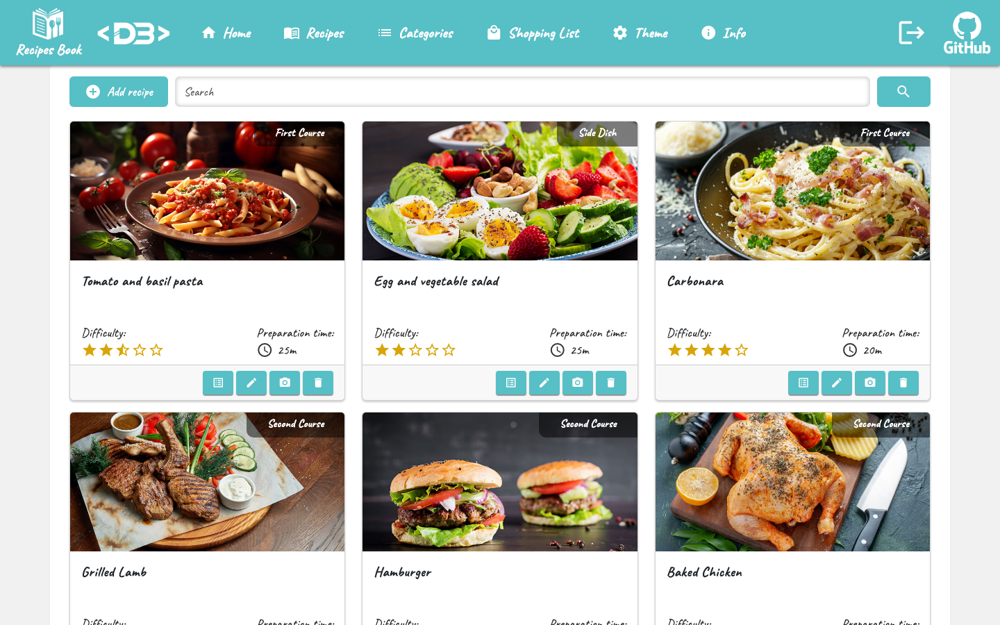
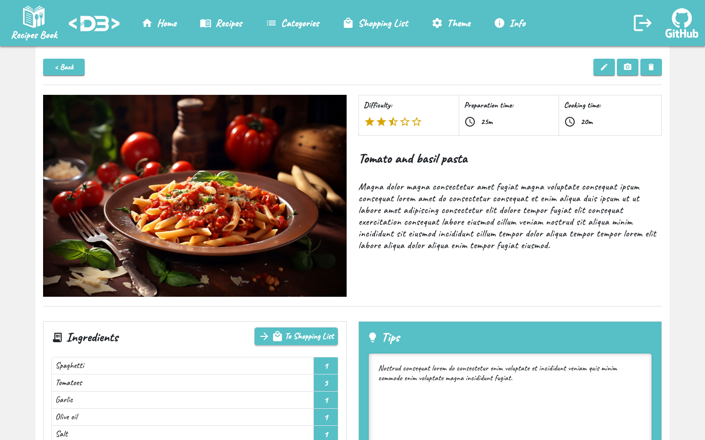

# Angular Recipes App

Recipe book built with Angular: browse recipes by category, read ingredients and tips, add ingredients to a shopping list and manage recipes. It is the frontend of a Spring Boot 3 REST API.

**Live demo:** <https://angular-recipes.davidebalice.dev>

The demo runs in read-only mode: create, update and delete operations are disabled by the backend.





## Features
- Login with JWT authentication (token stored in `localStorage` and sent by an HTTP interceptor)
- Recipe list with pagination, keyword search and category filter
- Recipe detail with difficulty, preparation and cooking time, ingredients and tips
- Create and edit recipes, upload a recipe photo
- Shopping list: add the ingredients of a recipe and edit the list
- Theme page to change the main colour of the interface
- Delete confirmation and demo-mode modals (Bootstrap)

## Tech stack
- [Angular 22](https://angular.dev/) (NgModules, reactive and template-driven forms)
- [Angular Material](https://material.angular.dev/) (icons, buttons, tooltips)
- [Bootstrap 5](https://getbootstrap.com/) and [ngx-bootstrap](https://valor-software.com/ngx-bootstrap/) pagination
- [RxJS](https://rxjs.dev/)

Backend: [spring-boot3-recipes-api-app](https://github.com/davidebalice/spring-boot3-recipes-api-app) (Spring Boot 3 REST API with JWT security).

## Getting started

### Requirements
- Node.js 22.22 / 24.15 or later (required by Angular CLI 22)
- npm
- A running instance of the [backend API](https://github.com/davidebalice/spring-boot3-recipes-api-app)

### Installation
```bash
git clone https://github.com/davidebalice/angular-recipes-app.git
cd angular-recipes-app
npm install
```

### Configuration
The API base URL is set in `src/app/app-config.ts`:

```ts
export const AppConfig = {
  apiUrl: 'http://localhost:8081/api/v1',
};
```

Change it to the address of your backend before building for production.

### Available scripts

| Command | Description |
| --- | --- |
| `npm start` | Start the development server on <http://localhost:4200> |
| `npm run build` | Production build in `dist/angular-test/browser` |
| `npm run watch` | Development build in watch mode |
| `npm test` | Run the unit tests with Vitest |

## Project structure
```
src/app/
├── components/     # delete confirmation and demo modals
├── header/ footer/ hero/ home/ info/ theme/
├── interceptors/   # API base URL and auth token interceptors
├── login/          # login page
├── recipes/        # list, card, detail, new, edit, photo and categories
├── services/       # auth, recipe, category and shopping list services, auth guard
└── shopping-list/  # shopping list and its editor
```

## Author

**Davide Balice** – [davidebalice.dev](https://www.davidebalice.dev)
